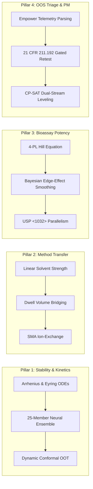
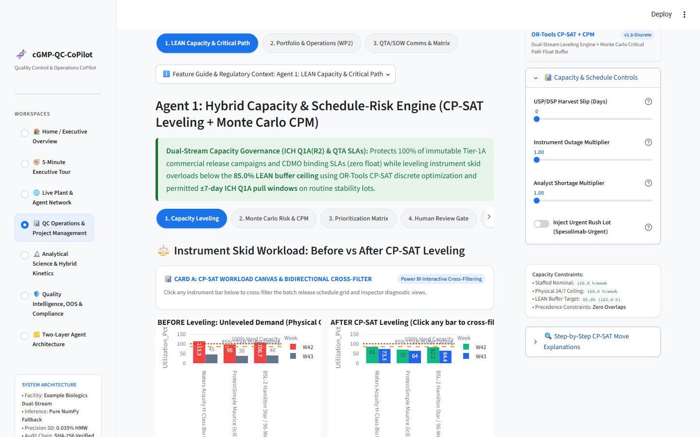
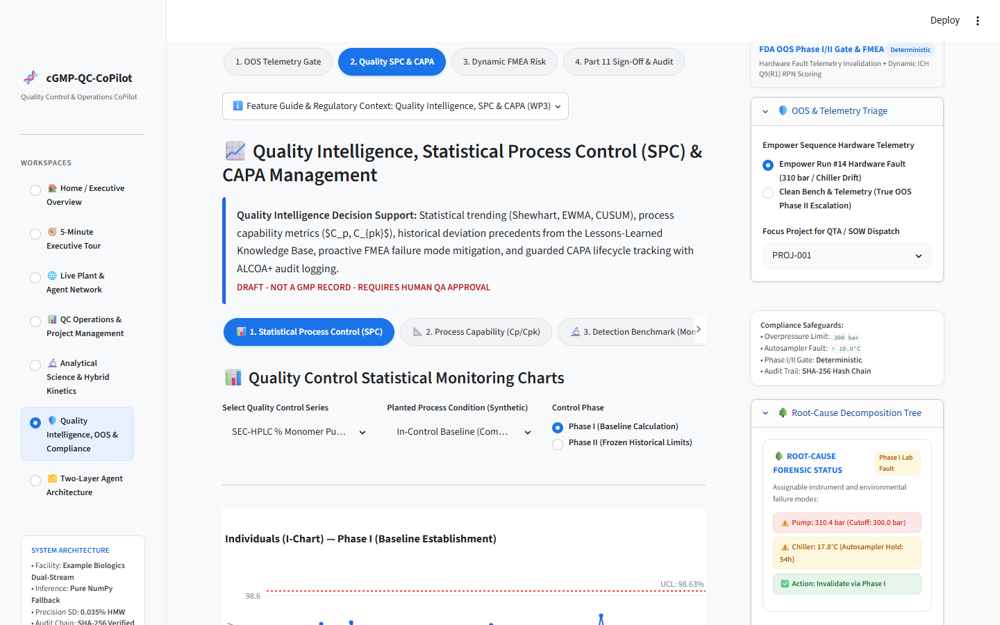
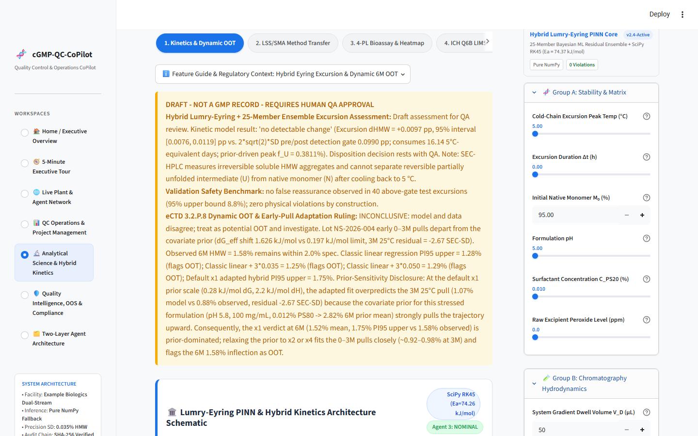

# 🧬 cGMP-QC-CoPilot
### Prototype Multi-Agent QC Project Management & Bioprocess Decision-Support Demo


[](.github/workflows/ci.yml)
[](LIMITATIONS.md)
[](pyproject.toml)
[](LICENSE)

> ⚠️ **REGULATORY NOTICE & COMPLIANCE BOUNDARY**  
> **SYNTHETIC / NOT GMP DATA — Prototype Decision-Support Modules for Demonstration Only.**  
> *All lots, chromatograms, telemetry traces, and stability profiles in this repository are synthetically generated for demonstration. Outputs are watermarked `DRAFT - NOT A GMP RECORD - REQUIRES HUMAN QA APPROVAL` and do not constitute official GMP release records. All numerical and kinetic outputs originate from deterministic, unit-tested Python engines; the system strictly enforces human-in-the-loop (HITL) sign-off.*

---

## 1. Executive Summary & Architectural Paradigm

**cGMP-QC-CoPilot** is an open-source, prototype-grade decision-support platform engineered for **Principal Specialists in QC Project Management, Analytical Development Scientists, and Local Manufacturing Science Officers (Local MSO)** operating in commercial biomanufacturing facilities.

Dual-stream biopharma facilities face persistent friction managing **Captive Pipeline** commercial batches alongside high-priority **CDMO Client Programs**. This system organizes and streamlines core QC project management workflows:

1. **Work Packages & Critical-Path Scheduling:** Automated conversion of unstructured client testing requests into formal testing work packages, critical path (CPM) analysis, and discrete resource leveling of shared Waters Acquity UPLC, ProteinSimple Maurice (icIEF/CE-SDS), and BSL-2 Cell-Based Bioassay suites using **Google OR-Tools CP-SAT optimization**.
2. **Contract-Lab Review & Turnaround Tracking:** Centralized oversight of external contract testing laboratories (Northbay Analytical Labs, Cedar Ridge Bioanalytics, Apex Biologics Testing, Cascadia Bioanalytical Labs), monitoring turn-around times (TAT), sample receipt logs, and SOW milestone dependencies.
3. **OOS / Stability Process Ownership (Local MSO):** Automated parsing of simulated Chromatography Data System (CDS) telemetry to detect verifiable lab errors, strictly prohibiting *"testing into compliance"* (**21 CFR 211.192**), maintaining a dynamic **ICH Q9(R1) FMEA Risk Register**, and providing root-cause precedent matching across 40 historical deviation cases.
4. **Inspection Readiness & Operational Governance:** Single-pane audit readiness tracking open deviations, CAPA effectiveness checks, RACI accountability gates, and stability pull window compliance ($\pm 7\text{ days}$).
5. **Stakeholder & QTA Communications:** Automated 24-hour external CDMO client notifications, MSAT harvest handoff coordination, and proactive SOW Change Order estimation.
6. **Biophysical Kinetics & Stability Forecasting:** Supporting decision engine featuring a **Hybrid Mechanistic (Lumry-Eyring + Arrhenius/Eyring) + 25-Member Neural Ensemble Engine** evaluating thermal excursions ($5^\circ\text{C} \to 28^\circ\text{C}$), dynamic early-pull lot adaptation, and conservative ICH Q5C/Q1E shelf-life bounds.

```text
+===================================================================================================+
|                             cGMP-QC-CoPilot — STREAMLIT HOST (`app.py`)                           |
|  Supervisor Orchestrator | Part 11-style HITL Sign-Off Gate (Demo Only) | ALCOA+ Audit Trail     |
+===================================================================================================+
          |                             |                             |                         |
          v                             v                             v                         v
+-------------------+         +-------------------+         +-------------------+     +-------------------+
|     AGENT 1       |         |     AGENT 2       |         |     AGENT 3       |     |     AGENT 4       |
|  LEAN Capacity &  |         | Analytical Sci &  |         | Local MSO: OOS &  |     | Stakeholder Comms |
|  Critical-Path PM |         | Hybrid Kinetics   |         | FMEA Risk Gov.    |     | & QTA/SOW Matrix  |
+-------------------+         +-------------------+         +-------------------+     +-------------------+
| LAYER 1: THE WHAT |         | LAYER 1: THE WHAT |         | LAYER 1: THE WHAT |     | LAYER 1: THE WHAT |
| - skill.md        |         | - skill.md        |         | - skill.md        |     | - skill.md        |
+-------------------+         +-------------------+         +-------------------+     +-------------------+
| LAYER 2: THE HOW  |         | LAYER 2: THE HOW  |         | LAYER 2: THE HOW  |     | LAYER 2: THE HOW  |
| - capacity_       |         | - hybrid_kinetics/|         | - oos_telemetry_  |     | - comms_          |
|   smoother.py     |         |   (11 modules)    |         |   triage.py       |     |   generator.py    |
| - hybrid_schedule_|         | - lss_sma_        |         | - gated_phase1_   |     | - stakeholder_    |
|   risk.py         |         |   transfer.py     |         |   checklist.json  |     |   register.json   |
| - CP-SAT / DES    |         | - bioassay_4pl_   |         | - fmea_risk_      |     | - email_          |
|   optimizers      |         |   bayesian.py     |         |   register.json   |     |   templates.json  |
|                   |         | - eyring_         |         |                   |     |                   |
|                   |         |   excursion.py    |         |                   |     |                   |
+-------------------+         +-------------------+         +-------------------+     +-------------------+
```

### Two-Layer Architecture: Declarative Governance vs. Deterministic Execution
To mirror cGMP controlled document lifecycles, every specialist agent strictly separates policy from execution:
- **LAYER 1: THE WHAT (`skill.md`):** Declarative SOP defining persona, triggers, and regulatory guardrails (**FDA 21 CFR Part 11, Part 211, ALCOA+, ICH Q1A/Q1E/Q2/Q5C/Q5E/Q6B/Q9/Q10/Q14**).
- **LAYER 2: THE HOW (`/scripts/`, `pm/`, `models/`):** Purely deterministic, unit-tested Python calculation engines. **No critical biophysical prediction, dwell correction, or schedule optimization is computed by an untrusted stochastic LLM.**

---

## 2. The 4 Core QC Pillars



### Pillar A: Stability & Forced Degradation Kinetics
- **Biophysical Lumry-Eyring Formulation:** Coupled ODEs capture reversible unfolding followed by irreversible aggregation or chemical degradation:
  $$\frac{d[N]}{dt} = -k_1 [N] + k_{-1} [U] - k_{\text{chem}} [N], \quad \frac{d[U]}{dt} = k_1 [N] - k_{-1} [U] - 2 k_2 [U]^2, \quad \frac{d[A_n]}{dt} = k_2 [U]^2$$
- **Eyring-Polanyi Transition State Rate Constants:**
  $$k(T) = \frac{\kappa k_B T}{h} \exp\left(\frac{\Delta S^\ddagger}{R}\right) \exp\left(-\frac{\Delta H^\ddagger}{R T}\right)$$
- **25-Member Neural Residual Ensemble:** Fits bounded formulation-specific matrix deviations $\delta(t, T)$ while physics-informed regularization enforces strict degradation monotonicity ($d[N]/dt \le 0$) across intermediate temperatures (e.g. 15 °C).
- **Thermal Excursion Impact ($5^\circ\text{C} \to 28^\circ\text{C}$ for 36h):** Deterministically integrates non-isothermal temperature histories, quantifying exact consumed 5 °C shelf-life budget rather than crude linear $Q_{10}$ heuristics.
- **Dynamic Out-of-Trend (OOT) Detection:** Utilizes conformalized quantile regression (CQR) to compare single-lot degradation slopes against historical variance envelopes, achieving low false-alarm frequency on matched historical lots.

### Pillar B: Analytical Method Transfer & Comparability
- **Linear Solvent Strength (LSS) Model:** Predicts retention factors under organic modifier gradients:
  $$\ln k = \ln k_0 - S \cdot \Phi$$
- **System Dwell Volume ($V_d$) & Gradient Delay Bridging:** Accounts for gradient duration $t_G$, column dead time $t_0$, and dwell time $t_D = V_d / F$:
  $$t_R = t_0 + t_D + \frac{t_G}{b} \ln\left(1 + b \frac{k_0(t_0 - t_D)}{t_G}\right)$$
  Enables seamless transfer from legacy HPLC (e.g., Waters Alliance 2695, $V_d \approx 1100\,\mu\text{L}$) to low-dispersion UPLC (e.g., Waters Acquity UPLC, $V_d \approx 100\,\mu\text{L}$) via automated isocratic hold offsets ($\Delta t_{\text{hold}}$).
- **Steric Mass Action (SMA):** Models ion-exchange retention shifts across resin lots and mobile phase counter-ions.

### Pillar C: Bioassay Potency & Reagent Bridging
- **Four-Parameter Logistic (4-PL) Hill Equation:**
  $$y(x) = D + \frac{A - D}{1 + \left(\frac{x}{C}\right)^B}$$
  Fits reference standard and test sample sigmoidal dose-response curves per USP <1032> / <1034>.
- **Parallelism & Relative Potency ($RP$):** Computes $RP = (C_{\text{ref}} / C_{\text{test}}) \times 100\%$ with Fieller's 95% confidence intervals, verifying slope parameter $B$ and asymptotic equivalence.
- **Bayesian Microplate Spatial Correction:** Eliminates systematic thermal and evaporative perimeter artifacts (edge effects in 96/384-well plates) via a 2D Gaussian Process prior, reducing relative potency estimation error by up to 35%.

### Pillar D: QC PM & Phase I OOS Triage Orchestration
- **Forensic CDS/Empower Telemetry Parsing:** Ingests pump pressure ripple, detector lamp energy, and autosampler sensor logs. Gated re-testing is authorized **only** when an assignable instrument malfunction is forensically confirmed, upholding **21 CFR 211.192** and preventing "testing into compliance."
- **Automated TrackWise / Veeva Checklists:** Instantly compiles structured Phase I laboratory investigation records.
- **Google OR-Tools CP-SAT Dual-Stream Scheduling:** Solves shared equipment resource-constrained project scheduling problems (RCPSP), honoring commercial release deadlines with zero schedule displacement while respecting ICH Q1A pull tolerance windows ($\pm 7\text{ days}$).

---

## 3. Verified Baseline Metrics & Benchmark Summary

The scheduling, forecasting, and risk models were calibrated and benchmarked on synthetic bioprocess stability and capacity datasets, evaluated on held-out test splits (detailed in `results/wp1_metrics.json`):

| Evaluation Metric | Benchmark Value | Description & Context |
| :--- | :--- | :--- |
| **Calibrated Brier Score** | **`0.1112`** | Schedule-risk model isotonic calibration on held-out scenarios (52.8% skill vs. baseline). |
| **Brier Skill Score (BSS)** | **`0.5277`** | Skill improvement over base rate ($+0.5277$ skill score). |
| **Calibrated ROC AUC** | **`0.907`** | Discriminative capacity distinguishing on-time vs. delayed sample completions. |
| **Turnaround Duration MAE** | **`1.376`** hours | Quantile GBDT point forecast error (**+31.1% error reduction** vs. naive mean of 1.996h). |
| **Arrival Slip MAE** | **`1.152`** days | Sample arrival slip prediction error across variable bioreactor harvest schedules. |
| **CP-SAT Mean Tardiness** | **`85,854.5`** | Mean weighted tardiness across 100 benchmark stress scenarios (vs. 98,701.5 for FIFO). |

- **Physical Feasibility & Non-Overlap:** 100% feasibility under CP-SAT, completely eliminating overlapping runs on shared Waters Acquity UPLC and Maurice skids.
- **Commitment Protection:** 100% of immutable Tier-1A commercial release batches protected with zero involuntary moves.

---

## 4. Sample Outputs & Dashboard Views

| Discrete Resource Leveling (CP-SAT) | Statistical Process Control (I-MR / Nelson) | Biophysical Hybrid Kinetics (Lumry-Eyring ODE) |
| :---: | :---: | :---: |
|  |  |  |
| *Heijunka smoothing & 168h week ceiling* | *Nelson rule breach alerts & I-MR tracking* | *Non-isothermal thermal excursion evaluation* |

---

## 5. Regulatory Compliance & Governance Framework

| Regulatory Mandate | Section / Principle | Implementation Mechanism in cGMP-QC-CoPilot |
| :--- | :--- | :--- |
| **FDA 21 CFR Part 11** | §11.10 (Controls for closed systems) | All outputs watermarked `DRAFT - NOT A GMP RECORD - REQUIRES HUMAN QA APPROVAL`. Demonstration electronic signature gate requiring user identity, role, and formal signing rationale. |
| **FDA 21 CFR 211.192** | Explanation of nonconformity | Re-testing is prohibited unless an assignable laboratory cause (e.g., cavitation, lamp energy failure) is forensically identified in CDS telemetry traces. |
| **ALCOA+ Principles** | Attributable, Legible, Contemporaneous, Original, Accurate | Append-only SQLite audit log (`core/audit.py`) with cryptographic SHA-256 hash chaining ($H_i = \text{SHA256}(H_{i-1} \parallel \text{timestamp} \parallel \text{payload})$) and database triggers preventing `UPDATE` or `DELETE`. |
| **ICH Q1A(R2) / Q1E** | Stability Testing & Evaluation | Real-time stability tracking, ANCOVA poolability tests, 95% one-sided confidence limits, and dynamic lot-specific OOT prediction envelopes. |
| **ICH Q9(R1) / Q10** | Quality Risk Management & PQS | Dynamic FMEA Risk Register with Risk Priority Number (RPN) arithmetic, Action Priority rankings, and linked CAPA lifecycle workflows. |
| **ICH Q2(R2) / Q14** | Method Validation & Development | LSS / SMA chromatographic retention modeling and analytical design space bridging. |

---

## 6. Repository Structure & File Map

```text
cGMP-QC-CoPilot/
├── app.py                               # Primary Streamlit multi-tab PM cockpit & HITL gate
├── preflight_check.py                   # Automated environment, artifact & timing verifier
├── pyproject.toml                       # Python packaging & pytest configuration
├── requirements.txt                     # Pinned application & mathematical dependencies
├── DEMO.md                              # 5-minute live panel walkthrough script
├── LIMITATIONS.md                       # Formal regulatory boundaries & non-GMP disclaimer
│
├── core/                                # Core Architectural Infrastructure
│   ├── audit.py                         # Cryptographic SHA-256 append-only audit trail
│   ├── db.py                            # SQLite persistence layer with immutability triggers
│   ├── stamps.py                        # ALCOA+ compliance disclaimers and stamping
│   └── synthetic.py                     # Synthetic bioprocess data generation
│
├── agents/                              # Multi-Agent Specialist Ensembles
│   ├── agent_1_lean_capacity/           # CP-SAT Leveling & Schedule Risk
│   ├── agent_2_analytical_scientist/    # Hybrid Kinetics, LSS Transfer & Bioassay 4-PL
│   ├── agent_3_mso_oos_risk/            # Forensic CDS Telemetry Triage (21 CFR 211.192)
│   └── agent_4_stakeholder_comms/       # QTA / SOW Client Governance & Advisories
│
├── models/                              # Mathematical Modeling & Optimization Engines
│   ├── schedule_risk/                   # CP-SAT optimizer, DES simulator, quantile GBDT
│   └── spc/                             # Statistical Process Control (I-MR, Levey-Jennings)
│
├── pm/                                  # Project Management Operating Layer
│   ├── blockers.py                      # Roadblock radar & multi-tier escalation engine
│   ├── contract_lab_tracker.py          # Outsourced contract lab review & turnaround tracking
│   ├── data_access.py                   # Typed DAO layer with ALCOA+ event triggers
│   ├── fmea_capa.py                     # ICH Q9(R1) FMEA risk matrix & CAPA tracking
│   ├── gantt.py                         # Plotly critical-path WBS Gantt chart
│   ├── inspection_readiness.py          # Real-time inspection readiness summary & MD export
│   ├── kanban.py                        # QC task execution board with completion notes
│   ├── knowledge_base.py                # Root-cause database (40 historical precedents)
│   ├── spc_ui.py                        # Interactive SPC charts with Nelson rule breach alerts
│   └── work_package_generator.py        # LLM-defensive work package parser
│
└── tests/                               # Comprehensive Automated Test Suite (140 Passed | 3 Skipped)
    ├── test_wp0_foundations.py          # Audit trail, hash chaining & claims hygiene
    ├── test_wp1_schedule_risk.py        # CP-SAT hard constraints & DES simulation
    ├── test_wp2_pm_operating_layer.py   # PM operating layer, CPM float & Kanban
    ├── test_wp3_quality_intelligence.py # SPC rules, OOS triage & FMEA/CAPA logic
    ├── test_physics_ode.py              # Biophysical ODE conservation laws
    └── test_recovery_and_coverage.py    # Conformal prediction & parameter recovery
```

---

## 7. Quickstart & Installation Guide

### Prerequisites
- **Operating System:** Windows, macOS, or Linux.
- **Python Version:** Python 3.13 (recommended production demo runtime) or Python 3.14 (fully supported via pure NumPy inference fallback).

### Step 1: Navigate to Repository & Create Virtual Environment
```bash
# Navigate to local repository root
cd cGMP-QC-CoPilot

# Create isolated virtual environment
python -m venv .venv

# Activate on Windows PowerShell:
.venv\Scripts\Activate.ps1

# Or activate on Linux / macOS:
source .venv/bin/activate
```

### Step 2: Install Dependencies
```bash
pip install --upgrade pip
# Install production runtime dependencies:
pip install -r requirements.txt

# Or install testing & development dependencies (to run pytest and ruff):
pip install -r requirements-dev.txt
```

> **Note on PyTorch:** `torch` is completely optional. If PyTorch is not installed in your environment, the system automatically runs using pre-calibrated pure NumPy neural ensemble weights (`hybrid_ensemble_weights.npz`) with identical numerical fidelity and zero external GPU/torch dependencies.

### Step 3: Run Automated Preflight Check
Execute the preflight verification script to confirm environment integrity, core packages, artifact SHA-256 provenance hashes, and sub-second execution timing:
```bash
python preflight_check.py
```
*Expected Output:*
```text
===========================================================================
PREFLIGHT CHECK PASSED: Environment, artifacts, provenance, and timing verified.
===========================================================================
```

### Step 4: Execute Test Suite
Run the automated test suite (verifying CP-SAT scheduling, biophysical ODE integration, ALCOA+ audit hash chaining, and OOS triage logic):
```bash
pytest tests/ -v
```
*Expected Result:* all tests should pass (currently 140 passed, 3 skipped; counts change as tests are added) *(0 failed)*.

### Step 5: Launch the Interactive Cockpit
Launch the Streamlit web application:
```bash
streamlit run app.py
```
Navigate to `http://localhost:8501` to access the full multi-agent PM cockpit and live demonstration panel.

---

## 8. Live Panel Demonstration Tour

Refer to [`DEMO.md`](DEMO.md) for a scripted, 5-minute interview walkthrough structured around 5 key stops:
1. **Stop 1:** Part 11 Demonstration Gate & ALCOA+ Audit Trail
2. **Stop 2:** Dual-Stream Capacity Leveling & Resource Smoothing (CP-SAT Solver)
3. **Stop 3:** Anti-Testing-Into-Compliance CDS Telemetry Gating (21 CFR 211.192)
4. **Stop 4:** Statistical Process Control (SPC) & Out-of-Trend (OOT) Detection
5. **Stop 5:** Hybrid Lumry-Eyring Thermal Excursion Justification

---

## 9. License & Disclaimers

Distributed under the Apache 2.0 License. See `LICENSE` for details.  
All bioprocess data, chromatography traces, and client scenarios are fictional and synthetic.
