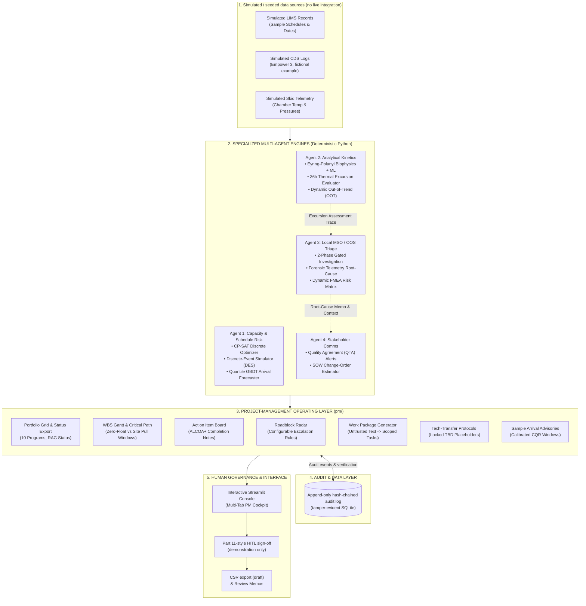

# System Topology & Architecture: cGMP-QC-CoPilot

> **Disclaimer:** DRAFT - NOT A GMP RECORD - REQUIRES HUMAN QA APPROVAL  
> *Designed to illustrate cGMP principles; demonstration prototype; not a validated system and not a compliant system.*

---

## 1. High-Level Mental Model

In a commercial biopharmaceutical Quality Control (QC) facility, two operational streams run concurrently:

```
           Captive Pipeline Lots                  External CDMO Client Lots
        (Internal Commercial mAb)               (External Contract Medicine)
                    │                                        │
                    ▼                                        ▼
    ┌────────────────────────────────────────────────────────────────────────┐
    │             SHARED TESTING INFRASTRUCTURE (Fictional Example)          │
    │  • UPLC Skids (e.g. Waters Acquity, fictional example)                 │
    │  • Capillary Electrophoresis (e.g. Maurice icIEF, fictional example)   │
    │  • BSL-2 Cell-Based Bioassay Suites                                    │
    │  • Walk-in Stability Chambers (5°C, 25°C, 40°C)                        │
    └────────────────────────────────────────────────────────────────────────┘
```

Both streams share the same physical instruments and testing personnel. When an upstream bioreactor harvest slips, an analytical instrument faults, or an assay variance arises, operational bottlenecks occur.

**cGMP-QC-CoPilot** is a prototype decision-support architecture that **helps surface and manage** these resource contentions, balances client SLAs against internal release deadlines, and provides structured documentation tools designed to illustrate cGMP quality risk management principles.

---

## 2. LLM Utilization Disclosure

> **Explicit Architectural Boundary:**  
> **There is no LLM in the calculation or decision path.**  
> - All schedule optimization, capacity leveling, biophysical ODE kinetics, out-of-trend boundaries, and discrete-event risk models are executed entirely by **deterministic, unit-tested Python engines**.  
> - Language models never compute numbers, evaluate dates, or disposition lots.  
> - Future optional LLM capabilities (Roadmap WP9, not implemented) are restricted strictly to drafting natural-language stakeholder memos from deterministic model outputs behind an adversarial prompt-injection filter and a strict number-lock verifier.

---

## 3. System Topology Diagram



---

## 4. Multi-Agent Engine Capabilities

| Agent | Domain | Function | Core Technology |
| :--- | :--- | :--- | :--- |
| **Agent 1: Capacity & Schedule Risk** | Capacity & Queue Dispatch | Evaluates instrument contention across shared skids. Shifts routine stability testing within site-defined pull windows (example $\pm 7\text{ d}$) to protect zero-float commercial releases without double-booking instruments. | Google OR-Tools CP-SAT, SimPy Discrete-Event Simulation, Quantile GBDT. |
| **Agent 2: Analytical Scientist** | Degradation Kinetics & Methods | Evaluates thermal excursions against a detection gate of 2√2 × SD (2σ of a difference of two measurements); estimates aggregate growth with an uncertainty interval and flags whether it is detectable against assay variability. | Eyring-Polanyi thermodynamics + 25-member Neural Network ODE ensemble. |
| **Agent 3: Local MSO (OOS Triage)** | Investigation & Quality Risk | Analyzes chromatography telemetry (pressures, temperatures) during Phase I investigations to flag candidate physical root causes for investigator review before recommending an investigation path. | Forensic CDS telemetry parser, FDA 2006 Phase I/II gated state machine, dynamic FMEA. |
| **Agent 4: Stakeholder Comms** | Matrix Governance | Drafts draft status updates under Quality Technical Agreements (QTAs) and estimates out-of-scope FTE impacts. | Deterministic rule-based template generation. |

---

## 5. PM Operating Layer Features

- **Portfolio Projects Grid:** Evaluates quantitative project status against configurable site thresholds ($P(\text{on time}) \ge 90\%$, float $\ge 2\text{d}$, zero critical blockers). Audited human overrides require contemporaneously recorded rationales.
- **WBS Interactive Gantt:** Contrasts rigid critical-path release dates against flexible site-defined pull windows (example $\pm 7\text{ d}$).
- **Roadblock Radar:** Tracks blocker aging; flags an escalation recommendation (example policy, configurable per site SOP: Tier 1 $\ge 5\text{d}$ to QA Director, Tier 2/3 $\ge 10\text{d}$ to QC PM Lead).
- **Work Package Generator:** Treats client request text as untrusted data, parses testing requirements into structured instrument hours, flags adversarial directives, and generates an auditable reasoning trace.
- **Sample Arrival Advisories:** Employs rolling-origin Conformalized Quantile Regression (CQR) to provide a calibrated arrival window around a baseline-level estimate (**85.7% empirical coverage [95% CI 77.5–91.8%, $n=105$ held-out; nominal level: 80.0%]**; point forecast ties simple baselines).
- **Tech-Transfer Protocols:** Standardizes analytical method transfers (ICH Q2/Q14) while strictly locking client specification limits to `[TBD - Client Specification Sign-Off Required; Never Auto-Populated]`.

---

## 6. End-to-End Operational Lifecycle Walkthrough

```
1. Upstream Harvest Slip
   A bioreactor run slips by 2 days upstream.
       │
       ▼
2. Sample Arrival Forecast (Agent 1 + PM Operating Layer)
   CQR forecaster computes a calibrated arrival window (e.g. Day 2.8 to Day 4.2, illustrative).
   A draft supervisory heads-up advisory is generated for analyst shift staging.
       │
       ▼
3. Contention Leveling (Agent 1 CP-SAT)
   The delayed lot collides on UPLC with a routine stability pull.
   CP-SAT levels the schedule by shifting the routine pull +6 days (illustrative) within
   site-defined pull windows (example ±7 d), strictly protecting the commercial lot.
       │
       ▼
4. Testing, Telemetry Audit & Excursion Evaluation (Agent 2 & Agent 3)
   If a thermal excursion occurs during transit, Agent 2 estimates aggregate growth
   with an uncertainty interval and flags whether it is detectable against assay variability.
   Agent 3 audits instrument telemetry: no telemetry anomaly flagged; analyst proceeds per SOP.
       │
       ▼
5. Quality Review & Audit Log Commit (HITL Governance)
   QC Project Manager completes a Part 11-style HITL sign-off (demonstration only).
   The action is recorded to the append-only, hash-chained log that supports
   ALCOA+ principles (tamper-evident, not tamper-proof).
   Draft LIMS schedule manifests and memos are exported for formal QA review.
```

---

## 7. cGMP Decision-Support Principles

1. **Non-GMP Classification:**  
   Every display and generated record carries the mandatory stamp:  
   `DRAFT - NOT A GMP RECORD - REQUIRES HUMAN QA APPROVAL`  
   The software is an advisory tool and does not release batches or approve deviations.
2. **Deterministic Computing:**  
   Language models are never in the calculation or decision loop. Numbers derive solely from deterministic, unit-tested Python code.
3. **Claims Hygiene:**  
   The system strictly prohibits and tests against affirmative claims such as `"RELEASE FOR USE"`, `"zero risk"`, `"validated"`, and `"guaranteed"`.
4. **Data Integrity Support:**  
   Operational events are written to an append-only, hash-chained log that supports ALCOA+ principles (tamper-evident, not tamper-proof).
